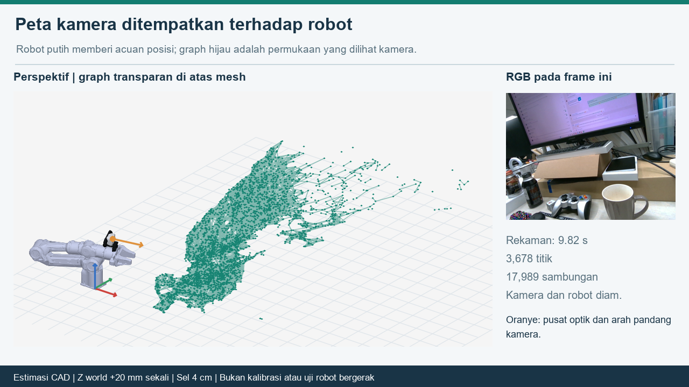
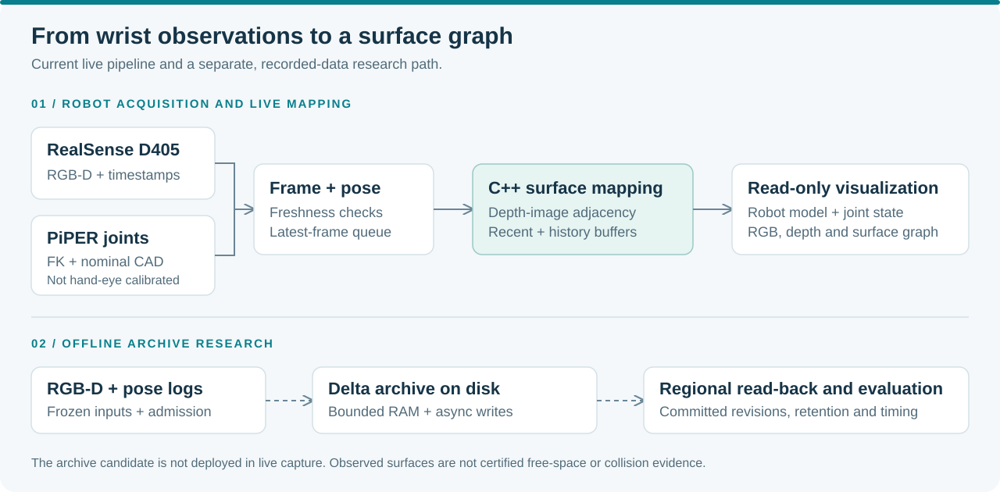
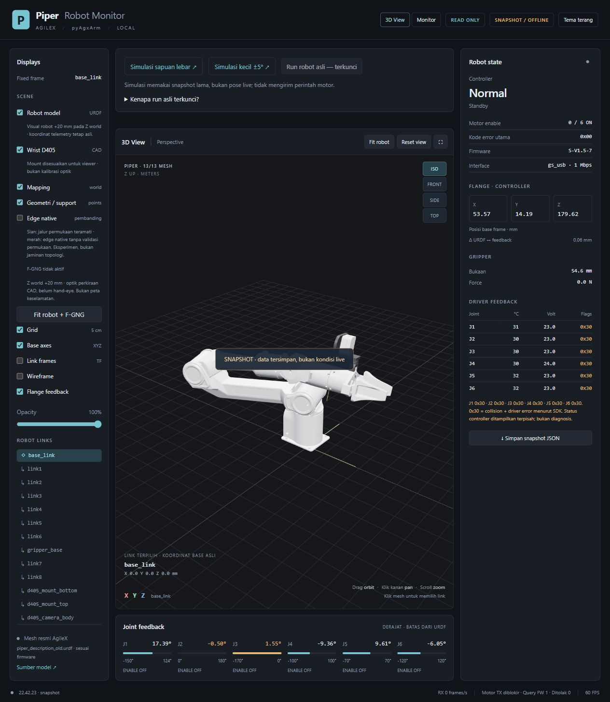
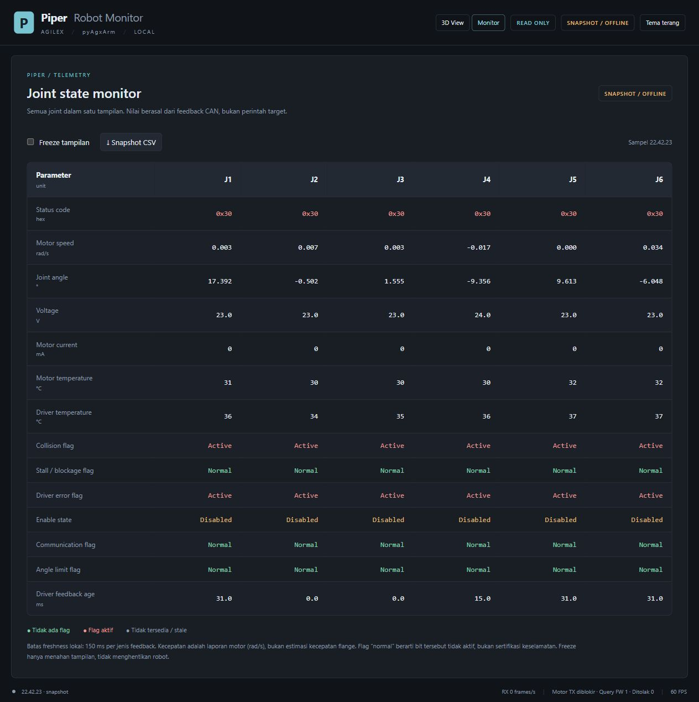
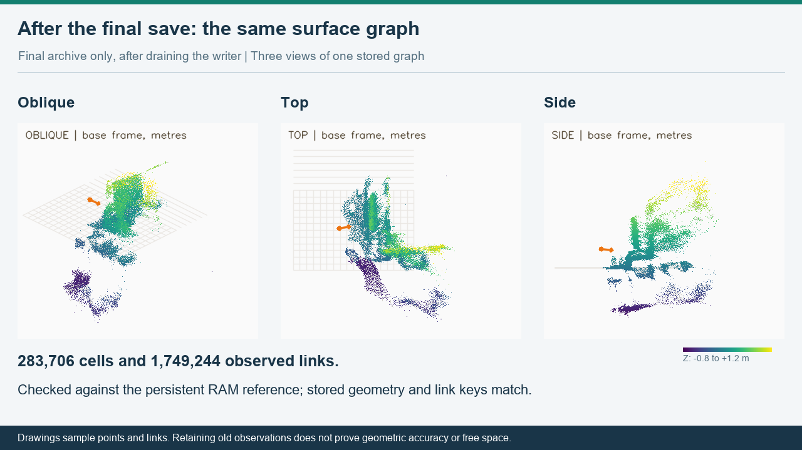

# OM6 PiPER

**Wrist-mounted RGB-D mapping for the AgileX PiPER arm.**

Inspect robot state, record RGB-D alongside joint feedback,
and study surface-graph mapping with a wrist-mounted RealSense D405.

[Quick start](#quick-start-existing-workspace) · [Documentation](docs/README.md) · [CAD & mechanics](docs/MECHANICAL_CAD.md) · [Research & demos](docs/research/README.md) · [Development](CONTRIBUTING.md)



*Existing CAD-based visualization with recorded camera data. Nominal camera placement; not a live robot state or a measured hand-eye calibration.*

## What is included

- **Robot viewer and joint monitor** — URDF meshes, fitted wrist-camera geometry,
  joint positions, driver flags, temperatures and explicit stale/snapshot labels.
- **Capture and tabletop scanning** — operator-run trajectories, RGB-D recordings,
  joint feedback logs and a read-only mapping viewer.
- **Surface mapping** — a native C++ worker using depth-image adjacency, with
  bounded recent and history buffers.
- **Archive research** — recorded-data experiments for persistent storage,
  background delta writes and bounded regional read-back.

> Research software for the existing Windows workspace. The archive prototype
> is not deployed in live capture. Maps and CAD previews are not collision-safety
> systems, and measured processing rates are not hard realtime guarantees.

## Quick start: existing workspace

Run these commands from the `om6_piper` folder. The launcher uses the existing
sibling `piper_readonly/.venv`; it does not install packages or automatically enable motors.

### 1. Check the installation — no hardware access

```powershell
.\piper.cmd doctor
.\piper.cmd --help
```

### 2. Open an offline snapshot

```powershell
.\piper.cmd gui --snapshot ..\output\motion_preflight_20261005_v1\robot_status.json --port 8768 --open
```

The viewer labels the data **SNAPSHOT / OFFLINE**. Historical flags are not a
diagnosis of the robot's current condition.

### 3. Monitor connected hardware

```powershell
.\piper.cmd gui --no-fgng --open
```

This opens the robot reader, but not the camera or motor control. The usual URL
is [localhost:8765](http://127.0.0.1:8765/).
For the existing camera-enabled viewer, use `run_viewer.cmd`.
Use only one CAN/camera owner at a time; close the monitor before a scan session.

Physical trajectories, fault clearing and disable procedures are documented
separately in [Robot operations](docs/ROBOT_OPERATIONS.md).
Opening this README, `doctor`, or the test runner does not authorize motion.

## System overview



Robot feedback and the nominal CAD transform locate depth observations in the
robot base frame. Host-side timing and freshness checks gate admission; this is
not hardware exposure synchronization. Display-only offsets are kept separate
from physical mapping coordinates.

### Camera mounting CAD

The user-provided source for the wrist-mount design is
[RealSense wrist mount for PiPER arm on GrabCAD](https://grabcad.com/library/realsense-wrist-mount-for-piper-arm-1).
The existing local STEP and Inventor files are retained under `cad/`; the viewer
uses derived meshes with a documented seating correction. See
[Mechanical and CAD](docs/MECHANICAL_CAD.md) for source provenance and transforms.

## Viewer and mapping examples

<details>
<summary><strong>3D viewer and joint-state monitor — actual offline screenshots</strong></summary>

<br>

| 3D robot and wrist camera | Joint-state monitor |
| --- | --- |
|  |  |

Both screenshots use the same saved observation. Fault indicators are preserved,
not replaced with artificial healthy values.

</details>

<br>



*Three views of one final offline archive after the writer drained. Stored geometry
and observed links match the RAM reference; that is a storage check, not ground-truth accuracy.*

See [Research and demonstrations](docs/research/README.md) for the local video
inventory, experiment scope and full development record.
[Image provenance](docs/images/README.md) records the source of each illustration.

## Repository layout

```text
om6_piper/
├── README.md                   Project overview and quick start
├── piper.cmd / piper.py         Common command-line entry point
├── run_viewer.cmd              Viewer shortcut
├── src/                        Capture, mapping, trajectories and research tools
├── piper_readonly/             Robot state, guarded maintenance and gateway
│   ├── web/                    3D viewer and joint-monitor frontend
│   └── assets/wrist_cad/        Active D405 meshes and mounting configuration
├── tests/                      Offline unit and integration tests
├── tools/                      Verification and repository utilities
├── examples/manual/            Isolated legacy hardware experiments
├── cad/                        STEP, Inventor dependencies and references
└── docs/
    ├── images/                 Local figures and screenshot provenance
    └── research/               Evidence guide and archived development log
```

Recordings remain in `output/`; recoverable backups and test logs live in
`.local/`. Both are ignored by Git. The root `trajectory_test.py` and
`print_joints.py` files are small compatibility adapters, not duplicate implementations.

**Not yet standalone:** the SDK, Python environments, official robot model,
native C++ builds, datasets and authoritative interlock still belong to the
parent workspace. Do not remove the sibling `piper_readonly` directory.
See [Repository layout and dependencies](docs/REPOSITORY.md) before relocating
or sharing the project.

## Tests and development

```powershell
.\piper.cmd test
```

The explicit offline suite blocks USB discovery and RealSense acquisition.
It covers robot-state semantics, control-policy contracts, camera transforms,
the read-only GUI, recording helpers and native mapping interfaces. Logs are
saved under `.local/test_runs/`; this is local verification, not a hosted CI badge.

Frontend development:

```powershell
cd piper_readonly
npm test
npm run build
```

Do not run unrestricted discovery over the workspace: legacy hardware scripts
are deliberately separated under `examples/manual/`.
Read [CONTRIBUTING.md](CONTRIBUTING.md) before changing capture, control or
research evidence.

## Documentation

| Topic | Guide |
| --- | --- |
| Daily use and commands | [Start here](docs/START_HERE.md) |
| Wake-up, clear error, disable and scanning | [Robot operations](docs/ROBOT_OPERATIONS.md) |
| State fields, units and freshness | [Robot state](docs/ROBOT_STATE.md) |
| Mounting, coordinate frames and CAD limitations | [Mechanical and CAD](docs/MECHANICAL_CAD.md) |
| Experiments, results and videos | [Research overview](docs/research/README.md) |
| Source layout and compatibility | [Repository guide](docs/REPOSITORY.md) |

No project-wide redistribution license has been assigned. Third-party SDK,
model, CAD and frontend components retain their own rights and notices; review
them before publishing a copy of this workspace.
